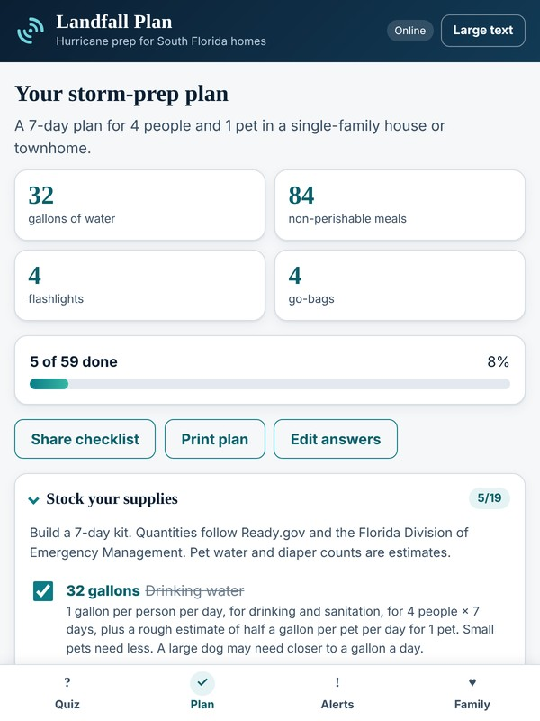

# Landfall Plan

A hurricane and storm-prep planner for South Florida households, built for the 2026 Congressional App Challenge.

**Live app:** [https://landfallplan.netlify.app](https://landfallplan.netlify.app)



Answer a short one-minute quiz about your household and home. Landfall Plan builds a personalized checklist with quantities sized to your family, shows live National Weather Service alerts for your location, and helps you fill in and print a family emergency plan. It works offline once loaded, needs no account, and keeps everything stored on your device.

## Features

- **Personalized checklist:** Water, food, diapers, medicine, pet supplies and more, sized to the number of people, pets, and days. Items change with your home type (house, condo, apartment, mobile home), shutters, generator, and medical needs.
- **Live weather alerts:** Pulls active alerts from the National Weather Service API (`api.weather.gov`, no key required) for South Florida in general (Miami-Dade, Broward, Palm Beach and Monroe counties) by default, or for your exact location once you allow location access. The app asks once and remembers your choice. Outside the United States there is no NWS coverage, as said by the app.
- **Family plan:** Emergency contacts, meeting places, evacuation destination, and neighbors to check on, printed cleanly.
- **Works offline:** A service worker caches the app so the plan opens with no power or internet, with the last alerts it fetched also being kept.
- **Private:** No accounts, no server, and no shared analytics. Data is kept in `localStorage` on the device, with an option to erase it.
- **Accessible:** Navigable through keyboard, screen-reader labels, large-text mode, and high-contrast focus outlines.

## Privacy

Everything you enter is kept on your device. The only network request the app makes is to `api.weather.gov` to fetch alerts, and if you allow location access, your device's coordinates are only sent there. Your choice is saved on your device. There are no accounts or cookies.

## Run it locally

It is plain HTML, CSS and JavaScript with no building step and no dependencies.

```
cd <repo-folder>
python3 -m http.server 8000
```

Then open http://localhost:8000 (Use a local server instead of directly accessing `index.html`, because the offline service worker only runs over `http://localhost` or `https`.)

Add `?demo=1` to the address (such as `http://localhost:8000/?demo=1#alerts`) to show a sample alert. This is useful for a demonstration of the app when no real alerts are active.

## Deployment

Hosted on [Netlify](https://landfallplan.netlify.app). There is no build command, and the publish directory is the repository root. If you change any files, update `CACHE_VERSION` in `sw.js` so that returning users get the update instead of a cached copy.

## Where the numbers come from

Quantities follow [Ready.gov](https://www.ready.gov/kit) and the [Florida Division of Emergency Management](https://www.floridadisaster.org/Kit):

- **Water:** 1 gallon per person per day for drinking and sanitation.
- **Duration:** defaults to 7 days, the Florida recommendation. Ready.gov's baseline is 3 to 5 days, and the app suggests at least 7 if you pick fewer.
- **Food:** 3 meals per person per day (infants are covered by formula and baby food).
- **Estimates (not official figures):** pet water (about half a gallon a day, more for large dogs), diapers (about 10 a day per infant), and counts for flashlights, power banks and go kits. The app lists these as estimates.
- **Hurricane watch and warning timing:** 48 and 36 hours per the National Hurricane Center.

## How it is organized

| File | What it does |
|---|---|
| `plan.js` | All the checklist logic/functions. |
| `app.js` | The interface for quiz, plan, alerts, family plan, saving, and offline status. |
| `index.html`, `styles.css` | Page structure and styling (prioritized for mobile, with a print stylesheet). |
| `sw.js`, `manifest.webmanifest` | Offline support and "add to home screen". |
| `submission/` | A 600×800 JPEG cover photo for the entry form, also used as an example screenshot above. |

## Disclaimer

Preparedness guidance is general. Landfall Plan is a planning aid, not a replacement for instructions from local emergency officials. In an emergency, follow local officials and call 911 for anything life-threatening.

## Credits

- Built by Liam Wellnitz, 2026.
- AI assistance: Claude (Anthropic) was used for South Florida storm-preparedness research, help with page formatting and CSS, debugging the location-permission logic, wording of some checklist items, and generating the icon images for the app. I wrote and tested the app and chose what to include.
- Weather alerts: [National Weather Service](https://www.weather.gov/) public API.

## License

Released under the [MIT License](LICENSE).